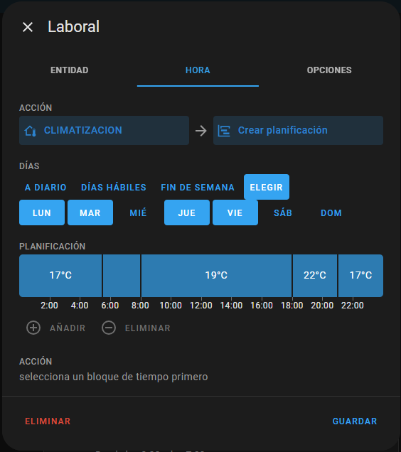
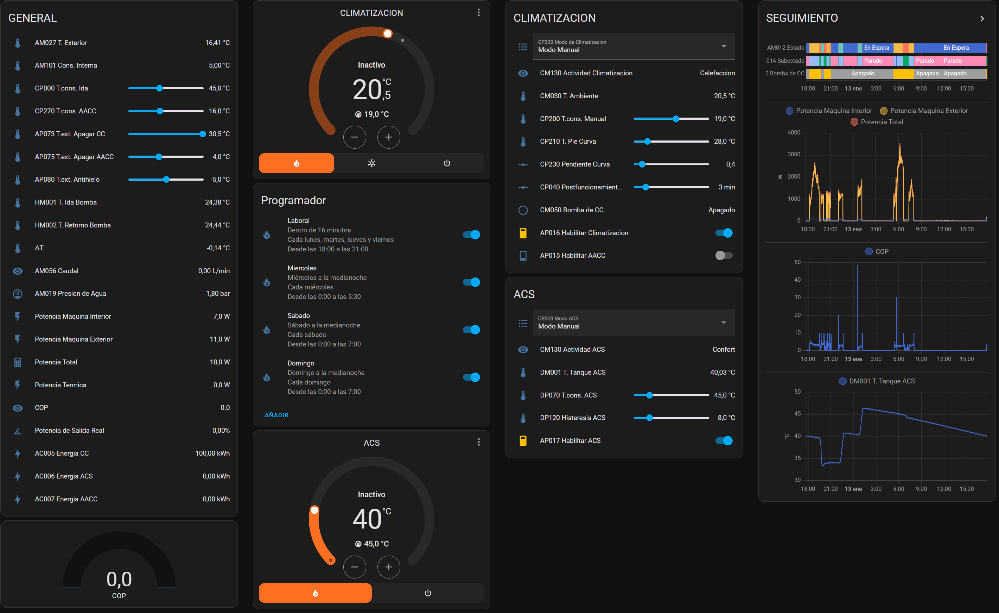
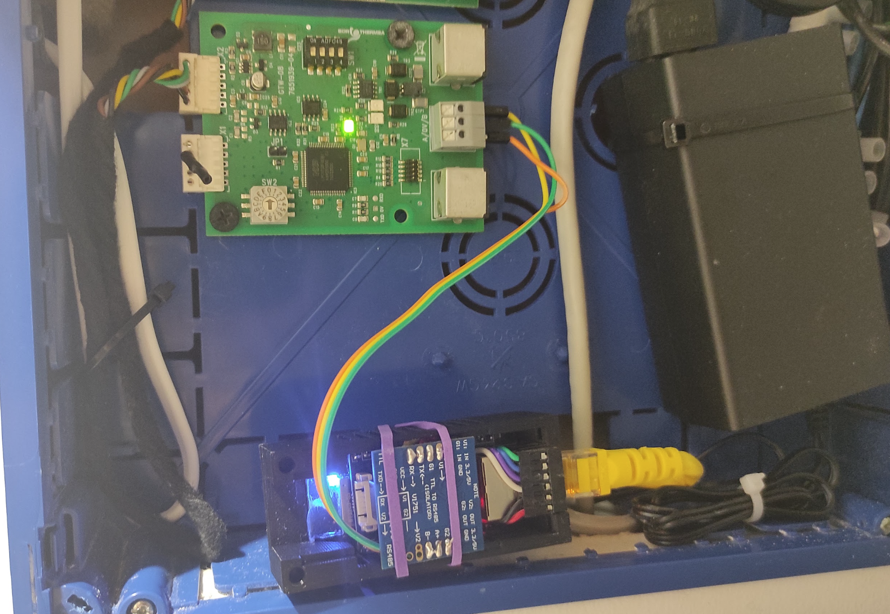
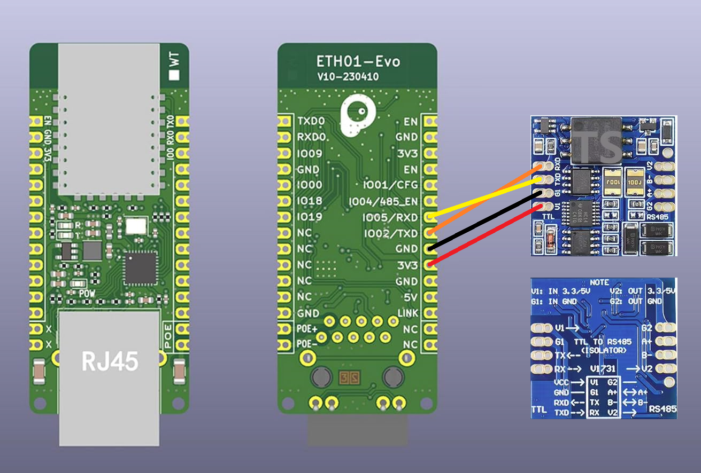

# Welcome to my second project! 

Hi!
This is Imanol82.
Here you have my second project.
With this project we can connect any Baxi/Dietrich/Remeha Aerothermal with Home Assistant using an ESP32. 
For this we will need the GTW-08 that converts the RBus into Modbus.

My system has 2 Zones. Zone 1 is the HVAC and Zone 2 is the DHW

It is the same system that I used in my first project, but changing the Modbus-TCP for an ESP32.

Over time we will complete it more.

Thanks!

-----------------------------------------------------------------------------------------------------------------------------------

# Version 0.2:
The idea is to use both the DHW and the Air Conditioning in manual mode, and use the Home Assistant scheduler to make programs, raise and lower the temperatures...

So I have changed the yaml to the minimum parameters that I think are interesting and I have configured a new dashboard.
The next thing will be to create 2 climate entities, one for the air conditioning and the other for the DHW.


Thank you!

-----------------------------------------------------------------------------------------------------------------------------------

# Version 1.0:
I have made the jump to version 1.0 because I think the system is already finished (except for small errors).

What has changed in this version:
- Two Climate entities have been added, one for DHW and the other for Heating/Cooling.
- For the configuration of the climate entity of the heating/cooling, I have used the Dual Mode Generic Thermostat entity that you will find on the following website: https://github.com/zacs/ha-dualmodegeneric
- The code has been divided into several files.

How I intend to use it:

The Baxi system will always be in manual mode.
Using the Home Assistant scheduler addon, I will schedule when I want the system to turn on or off or when I want the temperature to change.

An example of the scheduler:



An example of the dashboard:



The climates working:

[](https://www.youtube.com/watch?v=U0JB0XBZ2y4)


Thank you!


-----------------------------------------------------------------------------------------------------------------------------------

# Version 2.0:

The climate entities for ACS (DHW) and Climatización (Heating/Cooling) have been rebuilt using
[climate_template](https://github.com/jcwillox/hass-template-climate) instead of `generic_thermostat` /
`dualmode_generic`.

Why: `generic_thermostat` and `dualmode_generic` keep their own internal state (mode, target temperature),
completely decoupled from the real switches/numbers exposed by the ESP32. That forced 6 automations just
to keep both sides in sync (initial state on HA start + two-way sync for mode + two-way sync for
temperature), which was fragile and added a fixed delay on startup.

With `climate_template` the climate entity has no state of its own: its mode and temperature are templates
that read directly from `switch.ap017_habilitar_acs` / `number.dp070_t_cons_acs` (and the equivalent AACC
entities), and its actions call those same entities directly. No sync automations needed anymore, no
startup delay, and it can never drift out of sync.

What changed:
- `automations.yaml`: removed entirely (all 6 sync automations are no longer needed).
- `climate.yaml`: replaced `generic_thermostat`/`dualmode_generic` with `climate_template`.
- `switch.yaml`: removed — `acs_control` and `climatizacion_control` are now redundant.
- Requires the [climate_template](https://github.com/jcwillox/hass-template-climate) custom component via HACS.

Big thanks to [@jcwillox](https://github.com/jcwillox) for building and maintaining `climate_template` —
it's a fantastic component and it made this whole cleanup possible!


-----------------------------------------------------------------------------------------------------------------------------------

# Version 3.0:

The ESP32 configuration has been reviewed register by register against the official Remeha GTW-08 Modbus document,
and cross-checked with other projects ([houthacker/remeha-modbus](https://github.com/houthacker/remeha-modbus),
[martinsdan/UIMBaxiConnect-GTW08](https://github.com/martinsdan/UIMBaxiConnect-GTW08) and aio-remeha-modbus).
Everything has been tested on my own Baxi Platinum BC iPlus.

What changed:
- New file `esp32_3.0.yaml` (the old ESP32 files are kept for reference). It goes from 39 to 60 entities.
- All entities are now named with the code that appears in the Baxi manual / control panel (for example `AM012 Estado`,
  `HM001 T. Ida Bomba` or `CM190 Consigna Ambiente Actual`), so you can look them up in the manual.
  Entities with no code in the panel keep a descriptive name.
- Entities that I have not been able to confirm yet on my own unit are named `TEST_<register or code> ...`.
  They give real values, but use them with care.
- New entities: `AM016 Temp. Impulsion`, `Temp. Retorno Recibida`, `DM029 Consigna Impulsion ACS`,
  `CM030 T. Ambiente Alta Res.`, `CM190 Consigna Ambiente Actual`, `Consigna CC Aparato`, `HM033 Consigna Impulsion AACC`,
  `AM091 Modo Temporada`, `Estado Controlador Principal`, `Generador Activo`, `Peticion Especial Controlador`,
  `Modo Actual Zona Climatizacion`, `CP020 Funcion Zona 1`, `CP780 Estrategia Control Calefaccion`,
  `AP028 Tipo Refrigeracion`, `Fallo Presente`, `Codigo Error Aparato`, `Prioridad Error Aparato` and a `Reiniciar ESP32` button.
- The 3 energy entities `AC005`/`AC006`/`AC007` (registers 433, 435 and 437) have been removed: my unit never returned
  valid data for them. Instead, the ESP32 now calculates the thermal energy itself by integrating `Potencia Termica`:
  `Energia Termica Total` (never resets) and `Energia Termica Mensual` (resets on the 1st of each month).
- `Estado Aparato 1` and `Estado Aparato 2` (registers 279 and 280) now work: their bits are shown as text
  (for example "Bomba de Calor Encendida" or "Bomba, ACS Activa").
- `CP320 Modo ACS` is now `DP200 Modo ACS` (its real code), with the options of the manual.
- `Codigo Error Aparato` shows the error as in the panel (for example 02.23 = H02.23).
  `Fallo Presente` ignores the invalid value 255, which gave false alarms of 15 seconds.
- `Heater DUMB` and `Cooler DUMB` have been removed (they were only needed by the version 1.0 thermostat).
- Updated to the current ESPHome API (`modbus::helpers::word_from_hex_str`).
- The API key and the OTA password now use `!secret`. Add `api_encryption_key` and `ota_password` to your ESPHome `secrets.yaml`.
- `template.yaml`: `COP` now gives 0 when the heat pump is stopped (no more division by zero), and there are two new sensors,
  `COP Acumulado Mensual` and `COP Total` (see the template.yaml section below).
- `automations.yaml` and `switch.yaml` have been deleted from the repository. They were no longer used since version 2.0.

Note about entity IDs: Home Assistant may add a prefix (the device name, sometimes also the area) to the entity IDs it
creates, for example `sensor.baxi_am012_estado`. The `climate.yaml` and `template.yaml` files of this project use the
IDs without prefix (`sensor.am012_estado`), so rename your entities or adapt the YAML files.


Thank you!


-----------------------------------------------------------------------------------------------------------------------------------

# Installation:

First of all you need a GTW-08 gateway to convert the RBus signal to Modbus:


To read the Modbus signal, I will use an ESP32 with the typical TTL to RS485 reader.
I have used an ESP32 ETH POE, but any will work.:



The wiring diagram:



-----------------------------------------------------------------------------------------------------------------------------------

Now we will only have to create the ESP32 in ESPHome.

# - ESP32.yaml:
Remember to add `api_encryption_key` and `ota_password` to your ESPHome `secrets.yaml`, and to change `manual_ip` to your own network.

```
#This ESP32 device comes from Imanol82's GitHub project.
#Instructions for use can be found on github: https://github.com/Imanol82/Baxi-Dietrich-Remeha-to-Home-Assistant-with-an-ESP32
#Thank you very much!

substitutions:
  settings_skipped_updates: "30"
  devicename: "baxi_esp"

esphome:
  name: $devicename
  friendly_name: Baxi

esp32:
  board: esp32-c3-devkitm-1
## currently needed, but not in the future
  variant: esp32c3
  framework:
    type: esp-idf
 #   version: latest

# Enable logging
logger:
  baud_rate: 0

# Enable Home Assistant API
api:
  encryption:
    key: !secret api_encryption_key

ota:
  - platform: esphome
    password: !secret ota_password

ethernet:
  type: DM9051
  clk_pin: GPIO07
  mosi_pin: GPIO10
  miso_pin: GPIO03
  cs_pin: GPIO09
  interrupt_pin: GPIO08
  reset_pin: GPIO06
  clock_speed: 8MHz
  manual_ip:
    static_ip: 192.168.178.115
    gateway: 192.168.178.1
    subnet: 255.255.255.0
    dns1: 192.168.178.1

time:
  - platform: homeassistant
    id: homeassistant_time
    timezone: "CET-1CEST,M3.5.0,M10.5.0/3"
     
uart:
  id: mod_bus
  tx_pin: GPIO2
  rx_pin: GPIO5
  baud_rate: 9600
  stop_bits: 1

modbus:
  id: baxi_esp_modbus
#  flow_control_pin: 5
 
modbus_controller:
  - id: $devicename
    address: 0x64
    modbus_id: baxi_esp_modbus
    setup_priority: -10
    update_interval: "15s"
    command_throttle: "50ms"


##############################  ENERGIA TERMICA (calculada en el ESP32)  #
#
# Integra "Potencia Termica" (W) en el tiempo para dar kWh - el mismo
# calculo que hacias con "Integral de Riemann" + "Utility Meter" en HA,
# pero aqui, cada 60s. Solo el lado TERMICO: el electrico se queda en HA
# porque el ESP32 no tiene forma de medirlo.
#
# "Total" nunca se resetea (persiste en flash entre reinicios). "Mensual"
# se resetea solo el dia 1 de cada mes, usando la hora de Home Assistant
# (componente "time:" ya definido arriba en este mismo YAML).

globals:
  - id: energia_termica_total_kwh
    type: float
    restore_value: yes
    initial_value: '0'
  - id: energia_termica_mensual_kwh
    type: float
    restore_value: yes
    initial_value: '0'
  - id: ultimo_mes_reset
    type: int
    restore_value: yes
    initial_value: '0'

interval:
  - interval: 60s
    then:
      - lambda: |-
          float potencia_w = id(potencia_termica).state;
          if (isnan(potencia_w) || potencia_w < 0) return;

          float energia_kwh_intervalo = (potencia_w * 60.0 / 3600.0) / 1000.0;

          auto ahora = id(homeassistant_time).now();
          if (ahora.is_valid()) {
            int mes_actual = ahora.month;
            if (mes_actual != id(ultimo_mes_reset)) {
              id(energia_termica_mensual_kwh) = 0;
              id(ultimo_mes_reset) = mes_actual;
            }
          }

          id(energia_termica_total_kwh) += energia_kwh_intervalo;
          id(energia_termica_mensual_kwh) += energia_kwh_intervalo;

          id(energia_termica_total_sensor).publish_state(id(energia_termica_total_kwh));
          id(energia_termica_mensual_sensor).publish_state(id(energia_termica_mensual_kwh));


##############################  ENTITIES  ##############################


##############################  SENSORS  ###############################


sensor:

 
  - platform: modbus_controller                       #272 PowerActualReceived
    modbus_controller_id: $devicename
    name: "Potencia de Salida Real"   
    address: 272
    register_type: holding
    value_type: U_WORD
    unit_of_measurement: "%"
    accuracy_decimals: 2
    device_class: power_factor
    state_class: measurement
    filters:
      - multiply:  1

  - platform: modbus_controller                       #384 varApTOutside 
    modbus_controller_id: $devicename
    name: "AM027 T. Exterior"   
    address: 384
    register_type: holding
    value_type: S_WORD
    unit_of_measurement: "°C"
    accuracy_decimals: 2
    device_class: temperature
    state_class: measurement
    filters:
      - filter_out: -1
      - multiply:  0.01

  - platform: modbus_controller                       #403 varHpHeatPumpTF
    modbus_controller_id: $devicename
    name: "HM001 T. Ida Bomba"   
    id: hm001_t_ida_bomba
    address: 403
    register_type: holding
    value_type: S_WORD
    unit_of_measurement: "°C"
    accuracy_decimals: 2
    device_class: temperature
    state_class: measurement
    filters:
      - multiply:  0.01

  - platform: modbus_controller                       #404 varHpHeatPumpTR
    modbus_controller_id: $devicename
    name: "HM002 T. Retorno Bomba"  
    id: hm002_t_retorno_bomba
    address: 404
    register_type: holding
    value_type: S_WORD
    unit_of_measurement: "°C"
    accuracy_decimals: 2
    device_class: temperature
    state_class: measurement
    filters:
      - multiply:  0.01

  - platform: modbus_controller                       #405 varApInternalSetpoint
    modbus_controller_id: $devicename
    name: "AM101 Cons. Interna"   
    address: 405
    register_type: holding
    value_type: U_WORD
    unit_of_measurement: "°C"
    accuracy_decimals: 2
    device_class: temperature
    state_class: measurement
    filters:
      - multiply:  0.01

  - platform: modbus_controller                       #409 varApWaterPressure
    modbus_controller_id: $devicename
    name: "AM019 Presion de Agua"   
    address: 409
    register_type: holding
    value_type: U_WORD
    unit_of_measurement: "bar"
    accuracy_decimals: 2
    device_class: pressure
    state_class: measurement
    filters:
      - multiply:  0.1

  - platform: modbus_controller                       #410 varApFlowmeter
    modbus_controller_id: $devicename
    name: "AM056 Caudal"   
    id: am056_caudal
    address: 410
    register_type: holding
    value_type: U_WORD
    unit_of_measurement: "L/min"
    accuracy_decimals: 2
    device_class: volume_flow_rate
    state_class: measurement
    filters:
      - multiply:  0.01
      

  - platform: modbus_controller                       #1104 varZoneTRoom
    modbus_controller_id: $devicename
    name: "CM030 T. Ambiente"   
    id: cm030_t_ambiente
    address: 1104
    register_type: holding
    value_type: S_WORD
    unit_of_measurement: "°C"
    accuracy_decimals: 1
    device_class: temperature
    state_class: measurement
    filters:
      - multiply:  0.1

  - platform: modbus_controller                       #1631 varDhwTankTemperature
    modbus_controller_id: $devicename
    name: "DM001 T. Tanque ACS"   
    id: dm001_t_tanque_acs
    address: 1631
    register_type: holding
    value_type: S_WORD
    unit_of_measurement: "°C"
    accuracy_decimals: 2
    device_class: temperature
    state_class: measurement
    filters:
      - multiply:  0.01

  - platform: template
    name: "ΔT." 
    unit_of_measurement: "°C"
    accuracy_decimals: 2
    device_class: temperature
    state_class: measurement
    lambda: |-
      return (id(hm001_t_ida_bomba).state - id(hm002_t_retorno_bomba).state);

  - platform: template
    name: "Potencia Termica" 
    id: potencia_termica
    unit_of_measurement: "W"
    accuracy_decimals: 1
    device_class: power
    state_class: measurement
    lambda: |-
      return (id(am056_caudal).state * 60 * (id(hm001_t_ida_bomba).state - id(hm002_t_retorno_bomba).state) / 0.86);

  - platform: template                                 # Se rellena desde el interval de arriba, nunca se resetea
    name: "Energia Termica Total"
    id: energia_termica_total_sensor
    unit_of_measurement: "kWh"
    accuracy_decimals: 3
    device_class: energy
    state_class: total_increasing
    entity_category: diagnostic

  - platform: template                                 # Se rellena desde el interval de arriba, se resetea el dia 1 de cada mes
    name: "Energia Termica Mensual"
    id: energia_termica_mensual_sensor
    unit_of_measurement: "kWh"
    accuracy_decimals: 3
    device_class: energy
    state_class: total_increasing
    entity_category: diagnostic


##############################  CONFIRMADOS (doc oficial Remeha + martinsdan)  ###
#
# Estas 4 direcciones ya se han visto reaccionar con datos reales (ciclo
# sostenido de ACS/CC del 20/09): valores sensatos, sin sentinela, y
# 400/408 y 274 encajan con el documento oficial de Remeha y el proyecto
# martinsdan/UIMBaxiConnect-GTW08. Ya no llevan "TEST_".
#
# Codigos Baxi (los del manual de tu Platinum BC iPlus, estilo "HM001"):
# solo 408 tiene uno confirmado (DM029). 274, 400 y 1105 NO tienen
# codigo visible en el panel/instalador - son construcciones internas
# del propio gateway GTW-08 (por ejemplo 274/400 son el mismo dato
# "recibido" a nivel de controlador principal, no algo que el equipo
# muestre bajo un codigo propio), asi que se quedan con nombre
# descriptivo en vez de codigo.
#
# Se han quitado 3 duplicados exactos confirmados por el propio documento
# oficial (mismo indice interno CANopen, ej. 408 y la zona2 comparten
# "5604.0"): TEST_273 (= TEST_400, nivel "recibido" vs nivel "aparato"),
# TEST_1103 (= AM027, el mismo sensor exterior reflejado en la zona) y
# TEST_1613 (= 408, la misma consigna reflejada en la zona ACS).
#
# TEST_350/351 de tandas anteriores tambien se quitaron del todo: el
# documento oficial confirma que es un timestamp interno, no un sensor.

  - platform: modbus_controller                       #274 ReturnTemperatureReceived (doc oficial Remeha)
    modbus_controller_id: $devicename
    name: "Temp. Retorno Recibida"
    id: test_274
    address: 274
    register_type: holding
    value_type: S_WORD
    unit_of_measurement: "°C"
    accuracy_decimals: 2
    device_class: temperature
    state_class: measurement
    entity_category: diagnostic
    filters:
      - multiply: 0.01

  - platform: modbus_controller                       #400 varApTflow (doc oficial Remeha)
    modbus_controller_id: $devicename
    name: "AM016 Temp. Impulsion"
    id: test_400
    address: 400
    register_type: holding
    value_type: S_WORD
    unit_of_measurement: "°C"
    accuracy_decimals: 2
    device_class: temperature
    state_class: measurement
    entity_category: diagnostic
    filters:
      - multiply: 0.01

  - platform: modbus_controller                       #408 varDhwFlowTempSetpoint (doc oficial Remeha)
    modbus_controller_id: $devicename
    name: "DM029 Consigna Impulsion ACS"
    id: test_408
    address: 408
    register_type: holding
    value_type: U_WORD
    unit_of_measurement: "°C"
    accuracy_decimals: 2
    device_class: temperature
    state_class: measurement
    entity_category: diagnostic
    filters:
      - multiply: 0.01

  - platform: modbus_controller                       #1105 varZoneRoomTemperatureMeasured - zona 1 (circuito A): la misma temperatura ambiente que CM030 con resolucion de 0,01
    modbus_controller_id: $devicename
    name: "CM030 T. Ambiente Alta Res."
    id: test_1105
    address: 1105
    register_type: holding
    value_type: S_WORD
    unit_of_measurement: "°C"
    accuracy_decimals: 2
    device_class: temperature
    state_class: measurement
    entity_category: diagnostic
    filters:
      - multiply: 0.01


##############################  TEST - PENDIENTES DE CONFIRMAR  #########
#
# Estas 3 dieron valores reales (no sentinela) pero solo en reposo -
# AM091 (temporada) es estable por naturaleza; 406/HM033 son consignas
# de CC/AACC, y esos modos estaban apagados cuando se leyeron. Cuando
# vuelvas a activar CC o AACC un rato, confirmamos si reaccionan de
# verdad y les quitamos el "TEST_".
#
# Codigos Baxi: AM091 y HM033 confirmados en el manual de tu Platinum
# BC iPlus (coinciden nombre y descripcion exactos). 406 (varChSetpoint)
# no tiene codigo visible encontrado - parece otra construccion interna
# del gateway, se queda con el numero de registro tal cual.
#
# Se han borrado del todo (confirmado no soportado en tu hardware, sin
# ni un solo valor real en mas de 24h con ciclos sostenidos de ACS/AACC/
# CC de por medio): TEST_413 (Potencia de Salida %, sentinela 0xFFFF
# constante), TEST_460 (Potencia Real kW), TEST_463 (COP Umbral),
# TEST_456 (Corriente Unidad Exterior), TEST_9230 (COP Instantaneo),
# TEST_439 (Energia Total), TEST_453/459 (Velocidades de bomba),
# TEST_481 (Deshielo Activo).

  - platform: modbus_controller                       #406 varChSetpoint - consigna de CC del aparato (doc oficial + martinsdan) - confirmado, reacciona en CC y ACS
    modbus_controller_id: $devicename
    name: "Consigna CC Aparato"
    address: 406
    register_type: holding
    value_type: U_WORD
    unit_of_measurement: "°C"
    accuracy_decimals: 2
    device_class: temperature
    state_class: measurement
    entity_category: diagnostic
    filters:
      - multiply: 0.01

  - platform: modbus_controller                       #407 varHpCoolingSetpoint - consigna impulsion en modo refrigeracion (doc oficial + martinsdan; manual Platinum BC iPlus: HM033)
    modbus_controller_id: $devicename
    name: "HM033 Consigna Impulsion AACC"
    address: 407
    register_type: holding
    value_type: U_WORD
    unit_of_measurement: "°C"
    accuracy_decimals: 2
    device_class: temperature
    state_class: measurement
    entity_category: diagnostic
    filters:
      - multiply: 0.01


##############################  TEST - DOC OFICIAL (repaso completo GTW-08)  ####
#
# Repaso sistematico del documento oficial completo (capitulos Bewaking
# hoofdregeling, Apparaat, Service, Zonas) buscando todo lo que faltaba
# por poner. Se excluyen a proposito: horario semanal completo (sin
# valor como sensor), identificacion de placas/versiones (estatico),
# sensores de combustion (no aplican, es bomba de calor), Cascada y
# Deposito de Inercia (no aplican a tu instalacion).

  - platform: modbus_controller                       #1102 Valor de consigna de temperatura ambiente actual solicitado (CM190, escala 0.1 segun manual oficial)
    modbus_controller_id: $devicename
    name: "CM190 Consigna Ambiente Actual"
    address: 1102
    register_type: holding
    value_type: S_WORD
    unit_of_measurement: "°C"
    accuracy_decimals: 1
    device_class: temperature
    state_class: measurement
    filters:
      - multiply: 0.1

##############################  BINARY SENSORS  ########################


binary_sensor:

  - platform: modbus_controller                       #1110 varZonePumpRunning
    modbus_controller_id: $devicename
    name: "CM050 Bomba de CC"
    address: 1110
    register_type: holding

  - platform: modbus_controller                       #512 varApServiceRequired (AM011 segun el manual de Remeha; no figura en los manuales de Baxi)
    modbus_controller_id: $devicename
    name: "TEST_AM011 Servicio Requerido"
    address: 512
    register_type: holding

  - platform: modbus_controller                       #531 varApplianceOnError (el valor invalido 255 daba falsos "on" de 15 s; los fallos reales duran 2 min)
    modbus_controller_id: $devicename
    name: "Fallo Presente"
    address: 531
    register_type: holding
    filters:
      - delayed_on: 40s

  - platform: modbus_controller                       #275 bit 6 (0x40) - generador (compresor) activo, segun aio-remeha-modbus (ApplianceDemandStatus)
    modbus_controller_id: $devicename
    name: "Generador Activo"
    address: 275
    register_type: holding
    bitmask: 0x40

##############################  SWITCH  ################################


switch:

  - platform: modbus_controller                       #500 parApChEnabled
    modbus_controller_id: $devicename
    name: "AP016 Habilitar Climatizacion"
    id: ap016_habilitar_climatizacion
    address: 500
    register_type: holding
    use_write_multiple: True
    bitmask: 1
    
  - platform: modbus_controller                       #501 parApDhwEnabled
    modbus_controller_id: $devicename
    name: "AP017 Habilitar ACS"
    id: ap017_habilitar_acs
    address: 501
    register_type: holding
    use_write_multiple: True
    bitmask: 1
    
  - platform: modbus_controller                       #503 parApCoolingForced
    modbus_controller_id: $devicename
    name: "AP015 Habilitar AACC"
    id: ap015_habilitar_aacc
    address: 503
    register_type: holding
    use_write_multiple: True
    bitmask: 1


##############################  NUMBER  ################################


number:

  - platform: modbus_controller                       #386 parApSummerWinter
    modbus_controller_id: $devicename
    name: "AP073 T.ext. Apagar CC"
    address: 386
    use_write_multiple: false
    unit_of_measurement: "°C"
    device_class: temperature
    min_value: 15
    max_value: 30.5
    step: 0.5
    value_type: U_WORD 
    multiply: 100
    mode: BOX

  - platform: modbus_controller                       #387 parApNeutralBandSummerWinter
    modbus_controller_id: $devicename
    name: "AP075 T.ext. Apagar AACC"
    address: 387
    use_write_multiple: false
    unit_of_measurement: "°C"
    device_class: temperature
    min_value: 0
    max_value: 10
    step: 0.5
    value_type: U_WORD 
    multiply: 100
    mode: BOX

  - platform: modbus_controller                       #388 parApNeutralBandSummerWinter
    modbus_controller_id: $devicename
    name: "AP080 T.ext. Antihielo"
    address: 388
    use_write_multiple: false
    unit_of_measurement: "°C"
    device_class: temperature
    min_value: -30
    max_value: 20
    step: 0.5
    value_type: S_WORD 
    multiply: 100
    mode: BOX

  - platform: modbus_controller                       #664 parZoneRoomManualSetpoint
    modbus_controller_id: $devicename
    name: "CP200 T.cons. Manual"
    address: 664
    use_write_multiple: false
    unit_of_measurement: "°C"
    device_class: temperature
    min_value: 5
    max_value: 30
    step: 0.5
    value_type: U_WORD 
    multiply: 10
    mode: BOX

  - platform: modbus_controller                       #672 parZoneTFlowSetpointMax
    modbus_controller_id: $devicename
    name: "CP000 T.cons. Ida"
    address: 672
    use_write_multiple: false
    unit_of_measurement: "°C"
    device_class: temperature
    min_value: 7
    max_value: 100
    step: 0.5
    value_type: U_WORD 
    multiply: 100
    mode: BOX

  - platform: modbus_controller                       #673 parZoneTFlowCoolingMixingSetpoint
    modbus_controller_id: $devicename
    name: "CP270 T.cons. AACC"
    address: 673
    use_write_multiple: false
    unit_of_measurement: "°C"
    device_class: temperature
    min_value: 11
    max_value: 23
    step: 0.5
    value_type: U_WORD 
    multiply: 100
    mode: BOX

  - platform: modbus_controller                       #674 parZoneSlope
    modbus_controller_id: $devicename
    name: "CP230 Pendiente Curva"
    address: 674
    use_write_multiple: false
    min_value: 0
    max_value: 4
    step: 0.1
    value_type: U_WORD 
    multiply: 10
    mode: BOX

  - platform: modbus_controller                       #675 parZoneHCZPD
    modbus_controller_id: $devicename
    name: "CP210 T. Pie Curva"
    address: 675
    use_write_multiple: false
    unit_of_measurement: "°C"
    device_class: temperature
    min_value: 15
    max_value: 90
    step: 0.5
    value_type: U_WORD 
    multiply: 10
    mode: BOX

  - platform: modbus_controller                       #687 parZonePumpPostRun
    modbus_controller_id: $devicename
    name: "CP040 Postfuncionamiento Bomba"
    address: 687
    use_write_multiple: false
    unit_of_measurement: "min"
    min_value: 0
    max_value: 20
    value_type: U_WORD 
    multiply: 1
    mode: BOX

  - platform: modbus_controller                       #1177 parZoneDhwComfortSetpoint
    modbus_controller_id: $devicename
    name: "DP070 T.cons. ACS"
    address: 1177
    use_write_multiple: false
    unit_of_measurement: "°C"
    device_class: temperature
    min_value: 40
    max_value: 65
    step: 0.5
    value_type: U_WORD 
    multiply: 100
    mode: BOX

  - platform: modbus_controller                       #1198 parZoneDhwCalorifierHysterisis
    modbus_controller_id: $devicename
    name: "DP120 Histeresis ACS"
    address: 1198
    use_write_multiple: false
    unit_of_measurement: "°C"
    device_class: temperature
    min_value: 0
    max_value: 40
    step: 0.5
    value_type: U_WORD 
    multiply: 100
    mode: BOX


##############################  SELECT  ################################


select:

  - platform: modbus_controller                       #649 parZoneMode 1
    modbus_controller_id: $devicename
    name: "CP320 Modo de Climatizacion"
    address: 649
    use_write_multiple: false
    value_type: U_WORD
    optionsmap:
      "Programacion": 0
      "Modo Manual": 1
      "Antiescarcha": 2
    skip_updates: 2

  - platform: modbus_controller                       #1161 parZoneMode 2
    modbus_controller_id: $devicename
    name: "DP200 Modo ACS"
    address: 1161
    use_write_multiple: True
    value_type: U_WORD
    optionsmap:
      "Programacion": 0
      "Modo Manual": 1
      "Desactivado": 2
      "Temporal": 3
    skip_updates: 2

  - platform: modbus_controller                       #671 parZoneHeatingControlStrategy (CP780 en el panel)
    modbus_controller_id: $devicename
    name: "CP780 Estrategia Control Calefaccion"
    address: 671
    use_write_multiple: false
    value_type: U_WORD
    optionsmap:
      "Auto": 0
      "RTC (Solo Ambiente)": 1
      "OTC (Solo Curva)": 2
      "OTC+RTC (Mezcla)": 3
    skip_updates: 2

  - platform: modbus_controller                       #502 parApCoolingEnabled (doc oficial Remeha) - distinto de AP015/503, confirmado (manual Baxi: AP028, 0 apagado / 1 en funcionamiento / 2 gratuita)
    modbus_controller_id: $devicename
    name: "AP028 Tipo Refrigeracion"
    address: 502
    use_write_multiple: false
    value_type: U_WORD
    optionsmap:
      "Apagado": 0
      "Refrigeracion Activa": 1
      "Refrigeracion Libre": 2
    skip_updates: 2
  


##############################  BUTTON  ###########################


    
button:
  - platform: restart
    name: "Reiniciar ESP32"
    id: restart_button
  


##############################  TEXT SENSOR  ###########################


text_sensor:

  - platform: modbus_controller                       #279 ApplianceStatus1 
    modbus_controller_id: $devicename
    name: "Estado Aparato 1"
    address: 279
    register_type: holding
    bitmask: 1
    raw_encode: HEXBYTES
    lambda: |-
      uint8_t value = modbus::helpers::word_from_hex_str(x, 0);
      std::string result = "";
      if (value & 0x01) result += "Llama Encendida, ";
      if (value & 0x02) result += "Bomba de Calor Encendida, ";
      if (value & 0x04) result += "Respaldo Electrico Etapa 1 Encendido, ";
      if (value & 0x08) result += "Respaldo Electrico Etapa 2 Encendido, ";
      if (value & 0x10) result += "Respaldo Electrico ACS Encendido, ";
      if (value & 0x20) result += "Servicio Necesario, ";
      if (value & 0x40) result += "Reinicio Necesario, ";
      if (value & 0x80) result += "Presion de Agua Baja, ";
      if (result.empty()) return std::string("Ninguno");
      return result.substr(0, result.size() - 2);

  - platform: modbus_controller                       #280 ApplianceStatus2
    modbus_controller_id: $devicename
    name: "Estado Aparato 2"
    address: 280
    register_type: holding
    bitmask: 1
    raw_encode: HEXBYTES
    lambda: |-
      uint8_t value = modbus::helpers::word_from_hex_str(x, 0);
      std::string result = "";
      if (value & 0x01) result += "Bomba, ";
      if (value & 0x02) result += "V3V Abriendo, ";
      if (value & 0x04) result += "V3V, ";
      if (value & 0x08) result += "V3V Cerrada, ";
      if (value & 0x10) result += "ACS Activa, ";
      if (value & 0x20) result += "CC Activa, ";
      if (value & 0x40) result += "Refrigeracion Activa, ";
      if (result.empty()) return std::string("Ninguno");
      return result.substr(0, result.size() - 2);

  - platform: modbus_controller                       #411 varApStatus
    modbus_controller_id: $devicename
    name: "AM012 Estado"
    address: 411
    register_type: holding
    bitmask: 1
    raw_encode: HEXBYTES
    lambda: |-
      uint8_t value = modbus::helpers::word_from_hex_str(x, 0);
      switch (value) {
        case 0: return std::string("En Espera");
        case 1: return std::string("Demanda Calor");
        case 3: return std::string("Calentando CC");
        case 4: return std::string("Calentando ACS");
        case 6: return std::string("Postcirculacion Bomba");
        case 7: return std::string("Refrigeracion Activa");
        case 8: return std::string("Parada Controlada");
        case 9: return std::string("Bloqueado");
        case 10: return std::string("Bloqueo Temporal");
        case 11: return std::string("Test Carga Minima");
        case 12: return std::string("Test Carga Maxima");
        case 16: return std::string("Proteccion Antiheladas");
        case 17: return std::string("Purgado");
        default: return std::string("Desconocido");
      }
      return x;

  - platform: modbus_controller                       #412 varApSubStatus
    modbus_controller_id: $devicename
    name: "AM014 Subestado"
    address: 412
    register_type: holding
    bitmask: 1
    raw_encode: HEXBYTES
    lambda: |-
      uint8_t value = modbus::helpers::word_from_hex_str(x, 0);
      switch (value) {
        case 0: return std::string("Parado");
        case 1: return std::string("Ciclo Anticorto");
        case 2: return std::string("Cambio de Valvula a CC");
        case 3: return std::string("Alimentacion de Bomba del Sistema Hibrido");
        case 4: return std::string("Condiciones de Arranque Pendientes en Bomba y Respaldo");
        case 30: return std::string("Funcionamiento Normal");
        case 31: return std::string("Punto de Consigna Interno Limitado");
        case 60: return std::string("Posfuncionamiento de Bomba");
        case 62: return std::string("Cambio de V3V a ACS");
        case 65: return std::string("Derivacion del Compresor");
        case 66: return std::string("Temp. Superior a temp. Maxima de Funcionamiento del Compresor");
        case 67: return std::string("Temp. Exterior Inferior a Temp. Maxima de Funcionamiento del Compresor");
        case 68: return std::string("El Funcionamiento Hibrido Solicita Desactivacion del Compresor");
        case 69: return std::string("Deshielo en Curso");
        case 70: return std::string("No se reunen las Condiciones para Deshielo");
        case 71: return std::string("Deshielo en Curso");
        case 75: return std::string("Apagado del Compresor por Condensacion");
        case 76: return std::string("Apagado del Compresor por Caudal");
        case 78: return std::string("Correccion del Punto de Consigna de Temp.");
        case 79: return std::string("Derivacion de Compresor y Respaldo en Calefaccion/ACS");
        case 80: return std::string("Derivacion de Compresor y Respaldo en Refrigeracion");
        case 82: return std::string("Temp. Inferior a Temp. Minima de Refrigeracion");
        case 88: return std::string("BL-Respaldo Limitado");
        case 89: return std::string("BL-Bomba Limitada");
        case 90: return std::string("BL-Bomba y Respaldo Limitados");
        case 91: return std::string("BL-Tarifa Reducida");
        case 92: return std::string("PV-con Bomba de Calor");
        case 93: return std::string("PV-con Bomba de Calor y Respaldo");
        case 94: return std::string("BL-Red Electrica Inteligente");
        default: {
          char buf[24];
          snprintf(buf, sizeof(buf), "Subestado %u", (unsigned) value);
          return std::string(buf);
        }
      }
      return x;

  - platform: modbus_controller                       #1109 varZoneCurrentHeatingMode - sin codigo de panel (el CM130 real de la zona 1 es el 1107)
    modbus_controller_id: $devicename
    name: "Modo Actual Zona Climatizacion"
    address: 1109
    register_type: holding
    bitmask: 1
    raw_encode: HEXBYTES
    lambda: |-
      uint8_t value = modbus::helpers::word_from_hex_str(x, 0);
      switch (value) {
        case 0: return std::string("Off");
        case 1: return std::string("Calefaccion");
        case 2: return std::string("AACC");
        default: return std::string("Desconocido");
      }
      return x;

  - platform: modbus_controller                       #1619 varZoneCurrentActivities 2
    modbus_controller_id: $devicename
    name: "CM130 Actividad ACS "
    address: 1619
    register_type: holding
    bitmask: 1
    raw_encode: HEXBYTES
    lambda: |-
      uint8_t value = modbus::helpers::word_from_hex_str(x, 0);
      switch (value) {
        case 0: return std::string("Desactivado");
        case 1: return std::string("Reducida");
        case 2: return std::string("Confort");
        case 3: return std::string("Antilegionela");
        default: {
          char buf[24];
          snprintf(buf, sizeof(buf), "Valor %u", (unsigned) value);
          return std::string(buf);
        }
      }
      return x;

  - platform: modbus_controller                       #385 varApSeasonMode (doc oficial + manual Platinum BC iPlus: AM091) - confirmado, controla si CC/AACC pueden arrancar segun AP073/AP075
    modbus_controller_id: $devicename
    name: "AM091 Modo Temporada"
    address: 385
    register_type: holding
    bitmask: 1
    raw_encode: HEXBYTES
    lambda: |-
      uint8_t value = modbus::helpers::word_from_hex_str(x, 0);
      switch (value) {
        case 0: return std::string("Invierno");
        case 1: return std::string("Proteccion Antihielo Invierno");
        case 2: return std::string("Banda Neutra Verano");
        case 3: return std::string("Verano");
        default: return std::string("Desconocido");
      }
      return x;
    filters:
      - lambda: |-
          if (x == "Desconocido") return {};
          return x;

  - platform: modbus_controller                       #389 AP074 Modo verano forzado (solo lectura)
    modbus_controller_id: $devicename
    name: "TEST_AP074 Modo Verano Forzado"
    address: 389
    register_type: holding
    bitmask: 1
    raw_encode: HEXBYTES
    lambda: |-
      uint8_t value = modbus::helpers::word_from_hex_str(x, 0);
      switch (value) {
        case 0: return std::string("Desactivado");
        case 1: return std::string("Activado");
        default: {
          char buf[24];
          snprintf(buf, sizeof(buf), "Valor %u", (unsigned) value);
          return std::string(buf);
        }
      }
      return x;

  - platform: modbus_controller                       #275 ProducerManagerStatusBitfieldReceived - bitfield; significados segun aio-remeha-modbus (ApplianceDemandStatus), bit 6 = generador (compresor) activo; confirmado con las sesiones de ACS
    modbus_controller_id: $devicename
    name: "Estado Controlador Principal"
    address: 275
    register_type: holding
    bitmask: 1
    raw_encode: HEXBYTES
    lambda: |-
      uint8_t value = modbus::helpers::word_from_hex_str(x, 0);
      std::string result = "";
      if (value & 0x01) result += "Circuitos Directos Liberados, ";
      if (value & 0x02) result += "Circuitos Mezcla Liberados, ";
      if (value & 0x04) result += "Valvulas Abiertas o Bomba en Marcha (Seguridad), ";
      if (value & 0x08) result += "Demanda Manual de Calor, ";
      if (value & 0x10) result += "Refrigeracion Permitida, ";
      if (value & 0x20) result += "Circuitos ACS Liberados, ";
      if (value & 0x40) result += "Generador Activo, ";
      if (value & 0x80) result += "Bit 7 (sin documentar), ";
      if (result.empty()) return std::string("Ninguno");
      return result.substr(0, result.size() - 2);

  - platform: modbus_controller                       #276 ProducerManagerRequestReceived - enum, confirmado (patron dia/noche antiheladas)
    modbus_controller_id: $devicename
    name: "Peticion Especial Controlador"
    address: 276
    register_type: holding
    bitmask: 1
    raw_encode: HEXBYTES
    lambda: |-
      uint8_t value = modbus::helpers::word_from_hex_str(x, 0);
      switch (value) {
        case 0: return std::string("Proteccion Antiheladas");
        case 1: return std::string("Proteccion Antiheladas Solo Bomba");
        case 2: return std::string("Chimenea / Puesta en Marcha");
        case 3: return std::string("Solicitud de Servicio");
        default: return std::string("Ninguna");
      }
      return x;

  - platform: modbus_controller                       #277 Appliance Error - codigo en 2 bytes, decimal HH.LL (0x0217 = 02.23 = H02.23 Error circ. sistem., confirmado con un fallo real); 0xFFFF = sin error
    modbus_controller_id: $devicename
    name: "Codigo Error Aparato"
    address: 277
    register_type: holding
    bitmask: 1
    raw_encode: HEXBYTES
    lambda: |-
      uint16_t v = modbus::helpers::word_from_hex_str(x, 0);
      if (v == 0xFFFF) return std::string("Sin Error");
      char buf[32];
      snprintf(buf, sizeof(buf), "%02u.%02u (0x%04X)", (unsigned)(v >> 8), (unsigned)(v & 0xFF), (unsigned)v);
      return std::string(buf);

  - platform: modbus_controller                       #278 Appliance Error Priority - enum (3 = Bloqueo Temporal, confirmado con el fallo H02.23)
    modbus_controller_id: $devicename
    name: "Prioridad Error Aparato"
    address: 278
    register_type: holding
    bitmask: 1
    raw_encode: HEXBYTES
    lambda: |-
      uint8_t value = modbus::helpers::word_from_hex_str(x, 0);
      switch (value) {
        case 0: return std::string("Bloqueo");
        case 3: return std::string("Bloqueo Temporal");
        case 6: return std::string("Aviso");
        case 255: return std::string("Sin Fallo");
        default: return std::string("Desconocido");
      }
      return x;

  - platform: modbus_controller                       #513 varApCurrentOrUpcomingServiceNotification - enum, sin confirmar aun
    modbus_controller_id: $devicename
    name: "TEST_513 Notificacion Servicio"
    address: 513
    register_type: holding
    bitmask: 1
    raw_encode: HEXBYTES
    lambda: |-
      uint8_t value = modbus::helpers::word_from_hex_str(x, 0);
      switch (value) {
        case 1: return std::string("A");
        case 2: return std::string("B");
        case 3: return std::string("C");
        case 4: return std::string("Personalizado");
        case 5: return std::string("D");
        default: return std::string("Ninguna");
      }
      return x;

  - platform: modbus_controller                       #641 parZoneFunction - enum, confirmado (manual Baxi: CP020 Tipo de circuito, 5 = fancoil)
    modbus_controller_id: $devicename
    name: "CP020 Funcion Zona 1"
    address: 641
    register_type: holding
    bitmask: 1
    raw_encode: HEXBYTES
    lambda: |-
      uint8_t value = modbus::helpers::word_from_hex_str(x, 0);
      switch (value) {
        case 0: return std::string("Desactivado");
        case 1: return std::string("Directo");
        case 2: return std::string("Circuito Mezcla");
        case 3: return std::string("Piscina");
        case 4: return std::string("Alta Temperatura");
        case 5: return std::string("Fan Coil");
        case 6: return std::string("Tanque ACS");
        case 7: return std::string("Tanque ACS Electrico");
        case 8: return std::string("Programa Horario");
        case 9: return std::string("Calor de Proceso");
        case 10: return std::string("ACS Estratificado");
        case 11: return std::string("ACS BIC");
        case 12: return std::string("Tanque ACS Comercial");
        case 254: return std::string("ACS Primario");
        default: return std::string("Desconocido");
      }
      return x;

  - platform: modbus_controller                       #1107 Actividad de zona activa actual (CM130 real de la zona 1)
    modbus_controller_id: $devicename
    name: "CM130 Actividad Climatizacion"
    address: 1107
    register_type: holding
    bitmask: 1
    raw_encode: HEXBYTES
    lambda: |-
      uint8_t value = modbus::helpers::word_from_hex_str(x, 0);
      switch (value) {
        case 0: return std::string("Desactivado");
        case 1: return std::string("Reducida");
        case 2: return std::string("Confort");
        case 3: return std::string("Antilegionela");
        default: {
          char buf[24];
          snprintf(buf, sizeof(buf), "Valor %u", (unsigned) value);
          return std::string(buf);
        }
      }
      return x;

  - platform: modbus_controller                       #1108 Modo de funcionamiento actual de la zona (CM120)
    modbus_controller_id: $devicename
    name: "TEST_CM120 Modo Funcionamiento Climatizacion"
    address: 1108
    register_type: holding
    bitmask: 1
    raw_encode: HEXBYTES
    lambda: |-
      uint8_t value = modbus::helpers::word_from_hex_str(x, 0);
      switch (value) {
        case 0: return std::string("Programacion");
        case 1: return std::string("Modo Manual");
        case 2: return std::string("Desactivado");
        case 3: return std::string("Temporal");
        case 4: return std::string("Vacaciones");
        default: {
          char buf[24];
          snprintf(buf, sizeof(buf), "Valor %u", (unsigned) value);
          return std::string(buf);
        }
      }
      return x;


##############################  END  ###################################
```
-----------------------------------------------------------------------------------------------------------------------------------

# - configuration.yaml:
```
template: !include template.yaml
climate: !include climate.yaml
```
-----------------------------------------------------------------------------------------------------------------------------------

# - template.yaml:
```
###### CLIMATES BAXI ACS Y CLIMATIZACION ######


- sensor:
    - name: "COP"
      unique_id: cop_aerotermia
      unit_of_measurement: ""
      state: >
        
        
        
          {{ min(10, pt / pe) | round(2) }}
        
          0
        

    - name: "COP Acumulado Mensual"
      unique_id: cop_acumulado_mensual
      unit_of_measurement: ""
      state: >
        
        
        
          {{ (et / ee) | round(2) }}
        
          {{ this.state | float(0) }}
        

    - name: "COP Total"
      unique_id: cop_total
      unit_of_measurement: ""
      state: >
        
        
        
          {{ (et / ee) | round(2) }}
        
          0
        
```
The 3 COP sensors need the electrical power of your heat pump. In my case it is `sensor.meter_aacc_potencia`
(a "Combine the state of several sensors" helper that adds the power meters of the indoor and outdoor units),
and two more helpers created from the Home Assistant UI:
- `sensor.energia_electrica_total`: an "Integral" (Riemann sum) helper of `sensor.meter_aacc_potencia`, in kWh.
- `sensor.energia_electrica_mensual`: a monthly "Utility Meter" helper of `sensor.energia_electrica_total`.

-----------------------------------------------------------------------------------------------------------------------------------

# - climate.yaml:
```
##############################  CLIMATES BAXI ACS Y CLIMATIZACION  ##############################

######## ACS Thermostat (climate_template) ########

- platform: climate_template
  name: "ACS"
  unique_id: acs_climate_template
  modes:
    - "off"
    - "heat"
  min_temp: 40
  max_temp: 65
  temp_step: 0.5
  precision: 0.1
  current_temperature_template: "{{ states('sensor.dm001_t_tanque_acs') | float(0) }}"
  target_temperature_template: "{{ states('number.dp070_t_cons_acs') | float(0) }}"
  hvac_mode_template: >
    
      heat
    
      off
    
  set_temperature:
    - action: number.set_value
      target:
        entity_id: number.dp070_t_cons_acs
      data:
        value: "{{ temperature }}"
  set_hvac_mode:
    - choose:
        - conditions: "{{ hvac_mode == 'heat' }}"
          sequence:
            - action: switch.turn_on
              target:
                entity_id: switch.ap017_habilitar_acs
        - conditions: "{{ hvac_mode == 'off' }}"
          sequence:
            - action: switch.turn_off
              target:
                entity_id: switch.ap017_habilitar_acs

######## Climatizacion (climate_template) ########

- platform: climate_template
  name: "Climatización"
  unique_id: climatizacion_climate_template
  modes:
    - "off"
    - "heat"
    - "cool"
  min_temp: 5
  max_temp: 30
  temp_step: 0.5
  precision: 0.1
  current_temperature_template: "{{ states('sensor.cm030_t_ambiente') | float(0) }}"
  target_temperature_template: "{{ states('number.cp200_t_cons_manual') | float(0) }}"
  hvac_mode_template: >
    
      off
    
      cool
    
      heat
    
  set_temperature:
    - action: number.set_value
      target:
        entity_id: number.cp200_t_cons_manual
      data:
        value: "{{ temperature }}"
  set_hvac_mode:
    - choose:
        - conditions: "{{ hvac_mode == 'off' }}"
          sequence:
            - action: switch.turn_off
              target:
                entity_id:
                  - switch.ap016_habilitar_climatizacion
                  - switch.ap015_habilitar_aacc
        - conditions: "{{ hvac_mode == 'heat' }}"
          sequence:
            - action: switch.turn_on
              target:
                entity_id: switch.ap016_habilitar_climatizacion
            - action: switch.turn_off
              target:
                entity_id: switch.ap015_habilitar_aacc
        - conditions: "{{ hvac_mode == 'cool' }}"
          sequence:
            - action: switch.turn_on
              target:
                entity_id:
                  - switch.ap016_habilitar_climatizacion
                  - switch.ap015_habilitar_aacc

##############################  END  ##############################

```
-----------------------------------------------------------------------------------------------------------------------------------


# To do list:
- Confirm the 4 `TEST_` entities on my unit (`TEST_513 Notificacion Servicio`, `TEST_AM011 Servicio Requerido`,
  `TEST_AP074 Modo Verano Forzado` and `TEST_CM120 Modo Funcionamiento Climatizacion`).
- The energy registers 433, 435 and 437 never gave valid data on my unit. If they work on yours, please tell me!

-----------------------------------------------------------------------------------------------------------------------------------
I hope this project is useful and I hope to improve it with everyone's help. 

To be able to do this, I have received a lot of help from the telegram group "Aerothermia España/De Dietrich". 
# Thank you very much!

